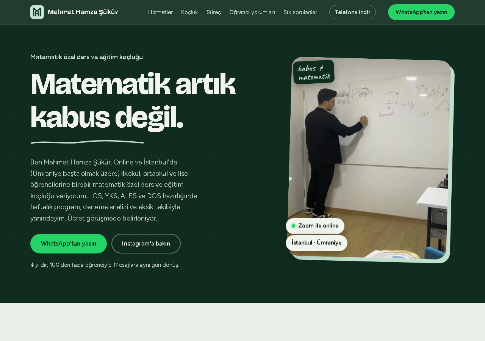

# Mehmet Hamza Şükür | Matematik Özel Ders ve Eğitim Koçluğu

**Canlı site:** https://mhmthamza.netlify.app/

Bu depo, sitenin **vitrinidir**. Siteyi nasıl tasarladığımı ve neler içerdiğini gösterir. Sitenin kaynak kodu, metinleri ve görselleri özel tutulur ve burada paylaşılmaz.

## Site nedir?

İlkokul, ortaokul ve lise öğrencilerine birebir matematik özel ders ve eğitim koçluğu veren **Mehmet Hamza Şükür** için hazırladığım tek sayfalık tanıtım sitesi. Online (Zoom) ve İstanbul Ümraniye'de yüz yüze ders sunuyor. Ziyaretçiyi doğrudan WhatsApp'tan iletişime geçirmek hedefleniyor.

## Öne çıkanlar

- **Hızlı:** Telefonda Lighthouse ölçümü (Ekim 2026): Performans 97, Erişilebilirlik 100, En İyi Uygulamalar 100, SEO 100.
- **Önce telefon:** Çoğu ziyaretçi telefondan geldiği için tasarım küçük ekrandan başlıyor. Altta yapışan "WhatsApp'tan yazın" çubuğu var.
- **Telefona indirilebilir (PWA):** Tarayıcıdan uygulama gibi eklenebilir, çevrimdışı da açılır.
- **Erişilebilir:** Klavye ile gezinme, görünür odak çizgisi, okunur renk kontrastı, hareketi azaltma ayarına saygı.
- **Güvenli:** İçerik güvenlik politikası (CSP) ve diğer güvenlik başlıkları.
- **Arama ve yapay zekâ dostu:** Yapılandırılmış veri (JSON-LD), site haritası, `llms.txt`.
- **Hafif:** Hazır bir çatı (framework) kullanılmadı. Saf HTML, CSS ve JavaScript.

## Teknolojiler

HTML, CSS, JavaScript, Service Worker, Netlify (barındırma ve otomatik yayın).

## İletişim

- Instagram: [@mhmthamza_](https://www.instagram.com/mhmthamza_/)
- Web: https://mhmthamza.netlify.app/

---

© Mehmet Hamza Şükür. Bu depodaki ekran görüntüleri ve içerik izinsiz kullanılamaz.
